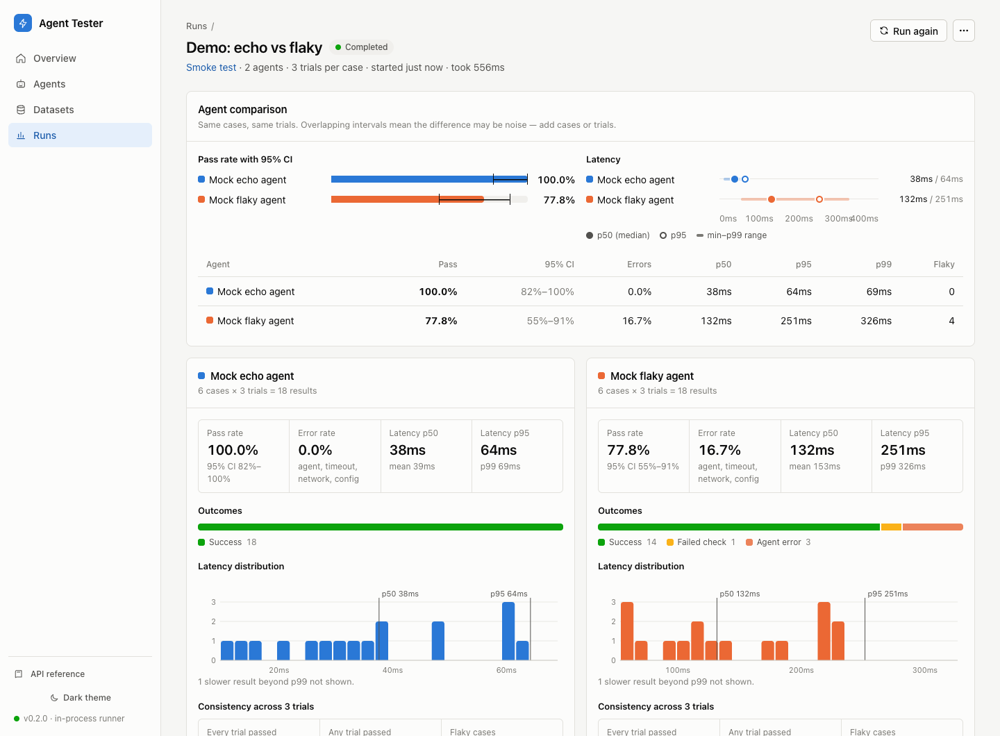

# Agent Tester

**Statistical evaluation for HTTP agents.** Run a dataset against any agent
endpoint, record every request and response, and get pass rates with
confidence intervals, latency percentiles and consistency across trials,
instead of a single pass/fail bit.



## Why

Agents are non-deterministic. The same prompt can pass on Monday and fail on
Tuesday, and a 90% pass rate on 10 cases tells you very little. Agent Tester
treats agent testing the way model evaluation does:

- **Distributions, not verdicts.** Pass rate with a Wilson 95% interval, error
  rate, latency p50/p95/p99 and a histogram, per agent and per tag.
- **Trials.** Run each case *k* times to see which answers are stable (pass^k),
  which are recoverable (pass@k) and which cases are flaky.
- **Full trajectories.** Every HTTP step (including async polling) with
  secrets masked, so a failure is one click from its cause.
- **Actionable outcome classes.** `agent_error`, `timeout`, `transport_error`
  and `config_error` separate "the agent is broken" from "your setup is broken".
- **Any HTTP agent.** A declarative contract (URL, headers, body template,
  JSONPath extraction, optional submit-and-poll) covers chat APIs,
  OpenAI-compatible gateways, workflow engines and job runners.
- **CI-native.** The same engine ships as a CLI with quality gates, JUnit XML
  and stable exit codes.

## Quick start

```bash
git clone <this repository> && cd agent-tester
cp .env.example .env
docker compose up --build
```

Open **http://localhost:3000** and click **Run the 30-second demo**. It compares
a reliable and a flaky mock agent on six cases with three trials each, and
opens the live report.

Then connect your own agent: **Agents → New agent**, pick a template (sync,
async, OpenAI-compatible), point it at your URL and press **Send test
request** to see the exact request and response before saving.

## In CI

```bash
pip install ./tester
agent-tester run \
  --agent agents/support-bot.json \
  --dataset evals/support.jsonl \
  --repeats 3 \
  --fail-under 0.90 --max-error-rate 0.05 \
  --junit reports/agent-eval.xml
```

Exit code `1` when a gate fails, `2` for invalid input, `3` if the run could
not complete. See the [CLI guide](docs/cli.md) for GitHub Actions and GitLab
examples.

## A contract and a case

```json
{
  "name": "Support bot (staging)",
  "contract": {
    "invoke": {
      "method": "POST",
      "url": "{{ agent.params.base_url }}/v1/chat",
      "headers": { "Authorization": "Bearer ${AGENT_API_KEY}" },
      "body_template": { "message": "{{ input.message }}", "session_id": "{{ uuid() }}" },
      "timeout_s": 60
    },
    "extract": { "final_text": "$.reply", "tokens": "$.usage.total_tokens" }
  },
  "params": { "base_url": "https://staging.example.com" }
}
```

```json
{"id": "refund-policy", "input": {"message": "Can I get a refund?"}, "expected": {"regex": "(?i)refund", "not_contains": ["I don't know"], "max_latency_ms": 5000}, "tags": ["billing"]}
```

`${AGENT_API_KEY}` is read from the runner's environment and never stored.

## Documentation

| | |
| --- | --- |
| [Getting started](docs/getting-started.md) | Install, run the demo, connect your first agent |
| [Concepts](docs/concepts.md) | Outcome classes, pass rate vs. success rate, intervals, trials |
| [Agent contracts](docs/agent-contracts.md) | Request templates, extraction, polling, secrets |
| [Datasets](docs/datasets.md) | Case format, checks, JSONL/JSON/CSV import |
| [CLI](docs/cli.md) | Headless runs, gates, JUnit, CI recipes |
| [API](docs/api.md) | REST API walkthrough (OpenAPI at `/api/docs`) |
| [Deployment](docs/deployment.md) | Configuration reference, runner modes, persistence |
| [Security](docs/security.md) | Threat model and hardening checklist |
| [Troubleshooting](docs/troubleshooting.md) | Symptom → cause → fix |
| [Architecture](docs/architecture.md) | How the pieces fit together |

## How it fits together

```
 Browser ──► UI (Next.js :3000) ──/api proxy──► Controller API (FastAPI :8000) ──► SQLite
                                                   │
                                                   └─ runner (agent_tester) ──► your HTTP agents
 CI job  ──► agent-tester CLI (same runner) ──────────────────────────────────► your HTTP agents
```

## Contributing

`make setup && make dev` gives you a hot-reloading stack; `make check` runs what
CI runs. See [CONTRIBUTING.md](CONTRIBUTING.md). Security reports:
[SECURITY.md](SECURITY.md).

## License

[Apache License 2.0](LICENSE)
